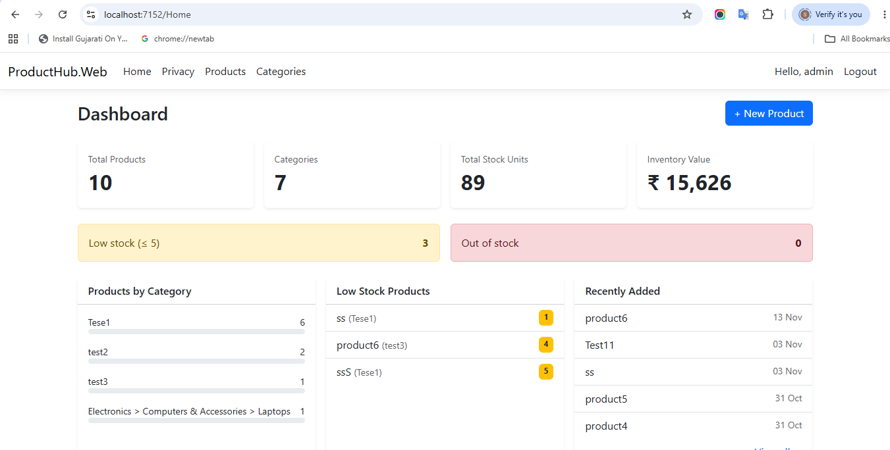
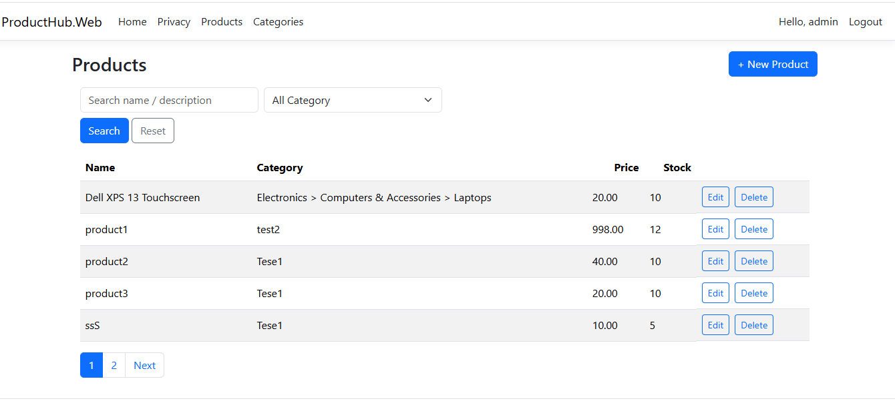
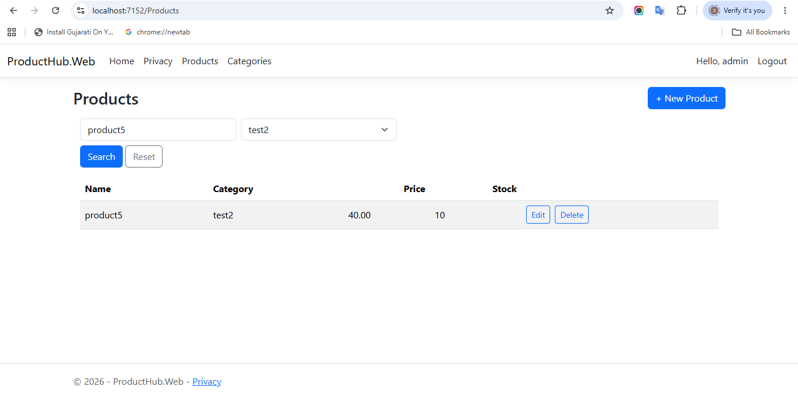
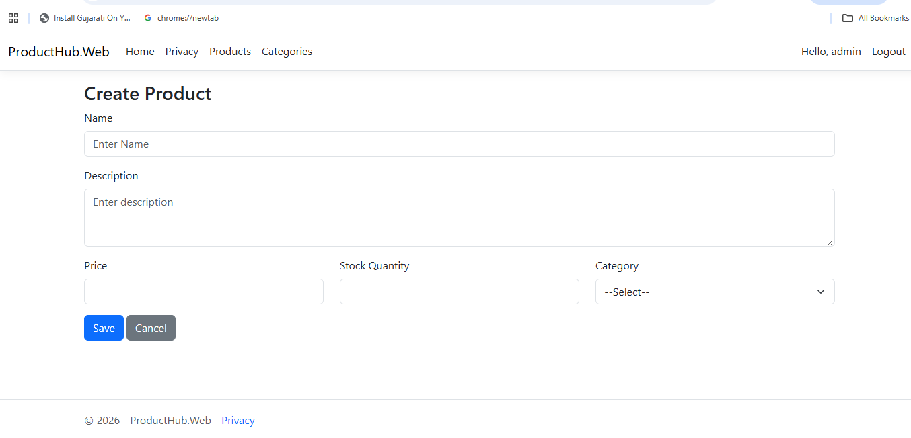
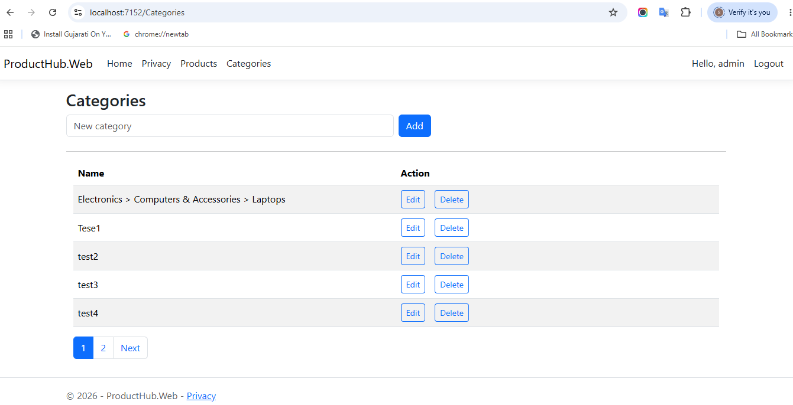

# ProductHub

A product and inventory management web application built with **ASP.NET Core MVC**, **Entity Framework Core** and **SQL Server**. It lets an authenticated user manage products and categories, search and filter the product list, and track stock from a summary dashboard.

## Screenshots

### Dashboard


### Products list with pagination


### Search and filter


### Create product


### Categories


## Features

- **Authentication**: login and logout; all pages are protected with `[Authorize]`
- **Dashboard**: total products, categories, total stock units, inventory value, low stock and out of stock counts, products by category, low stock list and recently added products
- **Product management**: create, edit and delete products with server-side validation
- **Search and filter**: search by name or description and filter by category; filters are kept while moving between pages
- **Pagination**: server-side paging on the product and category lists
- **Category management**: add, edit and delete categories
- **Responsive UI**: built with Bootstrap 5

## Tech Stack

| Layer | Technology |
|---|---|
| Framework | ASP.NET Core MVC (.NET 9) |
| Language | C# |
| ORM | Entity Framework Core (Code First, Migrations) |
| Database | Microsoft SQL Server |
| Frontend | Razor Views, Bootstrap 5 |

## Getting Started

### Prerequisites

- [.NET 9 SDK](https://dotnet.microsoft.com/download)
- SQL Server (LocalDB, Express or full edition)
- Visual Studio 2022 or VS Code (optional)

### Setup

1. **Clone the repository**
   ```bash
   git clone https://github.com/Shiva1743/ProductHub.git
   cd ProductHub/src/ProductHub.Web
   ```

2. **Configure the database connection**

   Copy `appsettings.Example.json` to `appsettings.Development.json` (or edit `appsettings.json`) and update the connection string:
   ```json
   {
     "ConnectionStrings": {
       "DefaultConnection": "Server=(localdb)\\MSSQLLocalDB;Database=ProductHubDb;Trusted_Connection=True;TrustServerCertificate=True"
     }
   }
   ```

3. **Create the database**
   ```bash
   dotnet ef database update
   ```

4. **Run the application**
   ```bash
   dotnet run
   ```
   Open the URL shown in the terminal (for example `https://localhost:7152`).

### Demo login

| Username | Password |
|---|---|
| `<demo-username>` | `<demo-password>` |

> Replace these with your actual demo credentials. Do not use real passwords here.

## Project Structure

```
ProductHub
└── src
    └── ProductHub.Web
        ├── Controllers   # Home (dashboard), Products, Categories, Account
        ├── Models        # Entities and view models
        ├── Data          # AppDbContext and migrations
        ├── Views         # Razor views and shared partials
        └── wwwroot       # Static files
```

## Key Implementation Notes

- Filtering and searching are applied to an `IQueryable` before counting and paging, so pagination stays correct with filters.
- Search and filter use `GET` requests, so result pages can be bookmarked and shared.
- Aggregates on the dashboard (counts, sums, group by category) run in the database rather than in memory.


